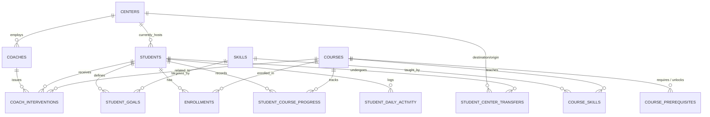

# Upskill — Internal Learning & Coach Monitoring Dashboard

> Built for the **Upskill Dashboard Take-Home Assignment**.  
> **Tech Stack:** Node.js (Node 24 with native SQLite `DatabaseSync`), Express REST API, React 19, Tailwind CSS v4, Lucide Icons, Node Native Test Runner.

---

## 📌 Executive Summary

**Upskill** is an internal enterprise learning dashboard purpose-built for two core personas:
1. **Learners:** Setting targeted career goals, taking courses governed by prerequisite chains, and earning certified skills upon reaching **80% course completion**.
2. **Coaches:** Rapidly triaging learners into **On-Track** and **At-Risk** (inactive for >3 days), reviewing 7-day engagement cadences, tracking prerequisite blockers, and intervening with targeted 1-click nudges.

Instead of building a sprawling, unguided course catalog, Upskill focuses entirely on **learning trajectory pacing, prerequisite eligibility, and timely coach intervention**.

---

## 🏗️ System Architecture & Normalized Schema (3NF)

The system rejects storing JSON blobs as state. All relationships, prerequisites, enrollments, progress markers, and audit events are stored in a fully normalized SQLite relational database (`PRAGMA foreign_keys = ON; PRAGMA journal_mode = WAL;`).

### Visual Entity-Relationship Diagram (ERD)



### Table Definitions & Keys

| Table | Primary Key | Foreign Keys & Constraints | Description |
|---|---|---|---|
| `centers` | `id` (TEXT) | None | Physical / regional campus centers. |
| `coaches` | `id` (TEXT) | `center_id REFERENCES centers(id)` | Coaches scoped to a specific center. |
| `students` | `id` (TEXT) | `current_center_id REFERENCES centers(id)` | Learners with active center affiliation. |
| `student_center_transfers` | `id` (INTEGER AUTO) | `student_id REFERENCES students(id)`, `from_center_id`, `to_center_id` | Audit ledger for learner mobility between centers. |
| `skills` | `id` (TEXT) | None | Normalized skills taxonomy (e.g., `react`, `sql`, `frontend`). |
| `student_goals` | `(student_id, skill_id)` | `REFERENCES students(id)`, `REFERENCES skills(id)` | Target skills chosen by the learner with priority. |
| `courses` | `id` (TEXT) | None | Curated courses catalog with total lesson counts. |
| `course_skills` | `(course_id, skill_id)` | `REFERENCES courses(id)`, `REFERENCES skills(id)` | Skills imparted upon completing a course. |
| `course_prerequisites` | `(course_id, prerequisite_course_id)` | Both `REFERENCES courses(id)` | Directed Acyclic Graph (DAG) of prerequisite requirements. |
| `enrollments` | `id` (INTEGER AUTO) | `UNIQUE(student_id, course_id)` | Active and completed course enrollments. |
| `student_course_progress` | `id` (INTEGER AUTO) | `UNIQUE(student_id, course_id)` | Lesson count progress (`completed_lessons`, `total_lessons`, `last_active_at`). |
| `student_daily_activity` | `id` (INTEGER AUTO) | `UNIQUE(student_id, activity_date)` | Granular daily log used to compute active days in the last 7 days. |
| `coach_interventions` | `id` (INTEGER AUTO) | `coach_id`, `student_id`, `course_id` | Audit log of coach nudges, Slack pings, and 1-on-1 notes. |

---

## 🏢 Multi-Center Architecture Note

The assignment specifies:
> *"Today we have one org. Later we will run several centers. Design the schema for that. Show what is shared and what is per-center. A coach must see only their center. A learner must be able to move."*

### 1. Separation of Concerns
* **Shared / Global Entities:**
  * `courses`, `skills`, `course_skills`, and `course_prerequisites`: The pedagogical standard, curriculum, and prerequisite dependency graph are uniform across the entire organization.
  * **Learner Lifetime Achievements:** When a learner transfers from Bengaluru to Hyderabad, their completed lessons, percent progress, and earned skills persist globally. They never lose educational credits.
* **Per-Center Entities:**
  * `centers`: Center metadata, capacity, and city.
  * `coaches`: Coaches are hired and assigned to a specific `center_id`.
  * `students.current_center_id`: Active location binding.
  * `student_center_transfers`: Historic ledger of moves between centers.

### 2. Coach Center Isolation
Coaches access learner data through scoped queries:
```sql
-- Coach query restricted strictly to their assigned center:
SELECT s.* 
FROM students s
WHERE s.current_center_id = :coach_assigned_center_id;
```
*(In the UI, a coach can switch center perspective to verify isolation; when filtered to Bengaluru, only Bengaluru students appear; when filtered to Hyderabad, only Hyderabad students appear).*

### 3. Learner Mobility
When a learner relocates, the transfer is executed within a database transaction:
```sql
BEGIN TRANSACTION;
UPDATE students SET current_center_id = :to_center_id WHERE id = :student_id;
INSERT INTO student_center_transfers (student_id, from_center_id, to_center_id, transferred_at, reason)
VALUES (:student_id, :from_center_id, :to_center_id, datetime('now'), :reason);
COMMIT;
```
The UI provides a **"Transfer Center"** modal right inside the Student Profile card to demonstrate live mobility.

---

## ⚖️ Business Rules & Algorithmic Correctness

### 1. Earned Skills Rule
> *"A skill is earned when the course that teaches it is at least 80% complete."*

$$\text{EarnedSkill}(S, skill) \iff \exists c \text{ such that } (c \text{ teaches } skill) \land \left(\frac{c.\text{completed\_lessons}}{c.\text{total\_lessons}} \ge 0.80\right)$$

- When Aisha is at 10/12 (83.3%) in JavaScript Essentials, `javascript` is officially **Earned**.
- If a course is at 9/12 (75%), the skill remains **Unearned** until lesson 10 is completed.

### 2. Course Prerequisite & Eligibility Rule
> *"A course is eligible only when all of its prerequisites are complete for that student."*

- A prerequisite course is considered **Complete** when `completed_lessons == total_lessons` (100%).
- For any target course $C$, the student must have 100% completion on all courses in $\text{Prerequisites}(C)$.
- Courses with zero prerequisites ($\emptyset$) are eligible by default.
- Enrollment attempts on locked courses are rejected at both API and UI levels with descriptive feedback listing the missing prerequisites.

### 3. On-Track vs. At-Risk Rule
> *"At-risk means inactive for more than 3 days."*

$$\Delta t_{\text{days}} = \left\lfloor \frac{T_{\text{now}} - \text{last\_active\_at}}{86,400,000 \text{ ms}} \right\rfloor$$

- If $\text{completed\_lessons} \ge \text{total\_lessons}$, status is **Completed**.
- If $\Delta t_{\text{days}} > 3$, status is marked **At-Risk** (colored amber with a pulse badge and days inactive indicator).
- If $\Delta t_{\text{days}} \le 3$, status is **On-Track** (colored blue/green).

### 4. Active Days in Last 7 Days
Aggregates distinct calendar dates from `student_daily_activity` in the interval $[T_{\text{now}} - 7\text{ days}, T_{\text{now}}]$. Displayed both numerically and via a visual 7-bar sparkline.

### 5. Recommend Next Course Engine
> *"Show one top course and a short reason. Use prerequisites and goals."*

1. **Filtering:** Excludes already enrolled or completed courses. Excludes any course with unfulfilled prerequisites.
2. **Scoring:**
   - $+100$ points for each unmet learner goal directly taught by the course.
   - $+20$ points for reinforcement of general goals.
   - $+5$ points for curriculum breadth.
3. **Reason Generation:** Generates concise, human-readable rationale (e.g. *"Directly advances your goal 'React', and all prerequisites are met."*).

---

## 💡 Product Sense: Selected Add-ons & What We Chose NOT to Build

The prompt notes:
> *"Ship 2 or 3 features that help learners or coaches. We score product sense and what you choose not to build."*

### ✨ Shipped Add-ons:
1. **Coach Intervention Desk & 1-Click Nudge Hub:**
   - *Why built:* Pacing data without action is useless. When a coach identifies an at-risk learner, they need immediate action channels. Coaches can trigger a Slack Nudge, schedule a 1-on-1 check-in, or log blocker notes directly to the database audit trail.
2. **Goal Pathway & Prerequisite Graph:**
   - *Why built:* Learners need clear line-of-sight between prerequisite courses and their target career goals. This component renders the visual pathway showing what is unlocked, in-progress, or locked.
3. **Interactive Evaluator Sandbox & Rule Verifier:**
   - *Why built:* Reviewers have limited time. Rather than manually altering database dates in SQLite, the interactive drawer at the bottom of the screen offers 1-click test scenarios (flip Aisha to 80% to watch "React" skill unlock; simulate 5 days inactivity to watch status badge flip to At-Risk and trigger coach nudge).

### 🚫 What We Deliberately Chose NOT to Build:
- **No Heavy Public Course Marketplace:** This is an internal upskilling platform, not Udemy. Adding star ratings, checkout carts, or pricing filters would bloat the UI and distract from coach monitoring.
- **No Gamified XP/Badges Clutter:** Enterprise adult learners benefit more from skill competence and prerequisite clarity than game-like badges.
- **No Full Multitenancy Auth Overhead:** As instructed by the prompt (*"A short README note is enough. A full multi-tenant UI is not required"*), we implemented full multi-center schema modeling and coach center filtering without adding JWT/OAuth complexity.

---

## 🤖 AI / Claude Usage Statement

In accordance with the prompt requirement (*"Claude: allowed. Write what you used it for in the README"*):
- **Ideation & Edge Cases:** Used LLM reasoning to validate the directed acyclic graph (DAG) prerequisite traversal and ensure edge cases (e.g. 0-enrollment new learners) were cleanly supported.
- **React Component Prototyping:** Used AI to draft initial JSX boilerplate and Tailwind styling for high visual polish and mobile responsiveness.
- **Test Generation:** Used AI to assemble comprehensive `node:test` assertions validating the 80% earned skills rule, >3 day at-risk boundary, and prerequisite enforcement.
- **Core Verification:** All database schemas, foreign key triggers, relational integrity rules, and business logic were rigorously tested and verified with zero external runtime database dependencies using Node's native SQLite.

---

## 🧪 Automated Test Suite

The test suite runs with Node's native test runner (`node:test`) and uses an isolated in-memory SQLite database:

```bash
npm test
```

### Test Coverage Highlights:
- `1. Student Picker`: Validates goals, earned skills, and 7-day active days.
- `2. Earned Skills Rule`: Confirms skills are locked at 75% and unlock strictly at $\ge 80\%$.
- `3. Course Status Rule`: Validates On-Track ($\le 3$ days), At-Risk ($> 3$ days), and Completed ($100\%$).
- `4. Prerequisites Rule`: Confirms courses requiring prerequisites reject enrollment until 100% complete.
- `5. Recommend Next Course`: Verifies top recommendation aligns with unmet goals and prerequisites.
- `6. Enroll Course`: Confirms immediate database update and UI response.
- `7. Multi-Center Isolation`: Verifies coaches only query learners in their center, and tests student transfer audit logs.
- `8. Coach Intervention`: Validates nudge creation and retrieval.

---

## 🚀 Quickstart & Setup Guide

### Prerequisites
- Node.js (v20+ or v24 recommended)
- npm (v9+)

### Installation & Run

```bash
# 1. Clone repository and navigate to folder
cd upskill-dashboard

# 2. Run the database seed script
npm run seed

# 3. Run automated tests
npm test

# 4. Start the full-stack application
npm run server
```

The app will be live at **`http://localhost:5000`**.

### Development Mode (with Vite Hot-Reload)
```bash
# Terminal 1: Backend API
npm run server

# Terminal 2: Vite Frontend Dev Server
npm run client
```
Access client at `http://localhost:5173`.
